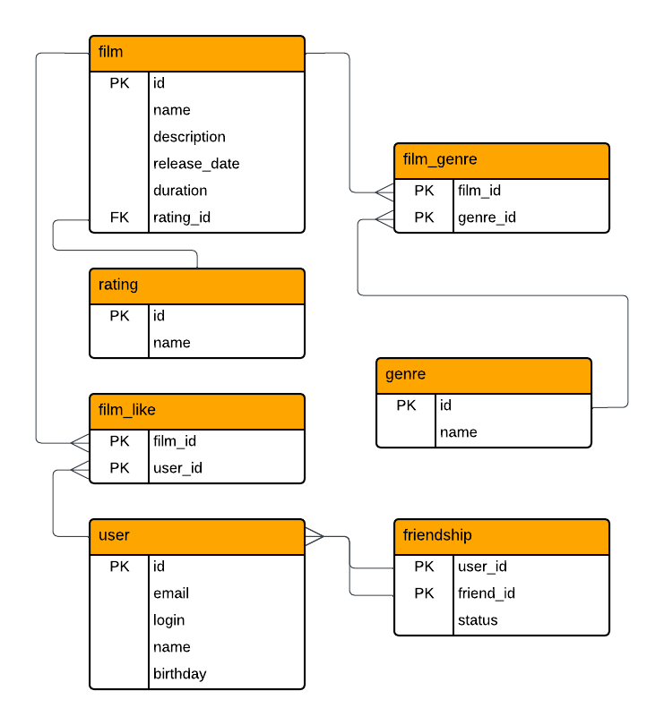

## Filmorate —  REST‑сервис фильмов и пользователей

Мини‑проект на Spring Boot для управления фильмами, пользователями, лайками и дружбой. Хранение данных — H2 (file‑mode) c автоматической инициализацией по `schema.sql` и `data.sql`.

### Стек
- **Java 21**, **Spring Boot 3** (Web, Validation, JDBC)
- **H2** (файловая БД: `./db/filmorate`), SQL‑скрипты: `schema.sql`, `data.sql`
- **Lombok**, **Checkstyle**, **Logbook** (логирование HTTP)

### Что реализовано
- CRUD для фильмов и пользователей
- Лайки к фильмам и выдача популярных фильмов
- Дружба пользователей и список общих друзей
- Справочники жанров (`/genres`) и рейтингов MPA (`/mpa`)
- Глобальная обработка ошибок и валидация входных данных

## Быстрый старт

### Предусловия
- JDK 21+
- Maven 3.9+

### Запуск в dev
```bash
mvn spring-boot:run
```
Приложение поднимется на `http://localhost:8080`.

### Сборка и запуск JAR
```bash
mvn clean package
java -jar target/filmorate-0.0.1-SNAPSHOT.jar
```

### Конфигурация
Основные настройки в `src/main/resources/application.properties`:
```properties
spring.datasource.url=jdbc:h2:file:./db/filmorate
spring.sql.init.mode=always
spring.sql.init.schema-locations=classpath:schema.sql
```
При первом старте схема создаётся автоматически. Данные хранятся в каталоге `db/` в корне проекта.

## API
Базовый URL: `http://localhost:8080`

### Фильмы `/films`
- Создать фильм
```bash
curl -X POST http://localhost:8080/films \
  -H "Content-Type: application/json" \
  -d '{
        "name": "The Matrix",
        "description": "Sci‑fi classic",
        "releaseDate": "1999-03-31",
        "duration": 136,
        "ratingId": 1,
        "genreIds": [1, 2]
      }'
```
- Обновить фильм
```bash
curl -X PUT http://localhost:8080/films \
  -H "Content-Type: application/json" \
  -d '{
        "id": 1,
        "name": "The Matrix",
        "description": "Updated",
        "releaseDate": "1999-03-31",
        "duration": 136,
        "ratingId": 1,
        "genreIds": [1]
      }'
```
- Получить все: `GET /films`
- Получить по id: `GET /films/{filmId}`
- Лайк: `PUT /films/{filmId}/like/{userId}`
- Снять лайк: `DELETE /films/{filmId}/like/{userId}`
- Популярные: `GET /films/popular?count=10`

### Пользователи `/users`
- Создать пользователя
```bash
curl -X POST http://localhost:8080/users \
  -H "Content-Type: application/json" \
  -d '{
        "email": "neo@matrix.io",
        "login": "neo",
        "name": "Neo",
        "birthday": "1971-09-02"
      }'
```
- Обновить: `PUT /users`
- Получить все: `GET /users`
- Получить по id: `GET /users/{userId}`
- Добавить в друзья: `PUT /users/{userId}/friends/{friendId}`
- Удалить из друзей: `DELETE /users/{userId}/friends/{friendId}`
- Список друзей: `GET /users/{userId}/friends`
- Общие друзья: `GET /users/{userId}/friends/common/{otherId}`

### Справочники
- Жанры: `GET /genres`, `GET /genres/{id}`
- Рейтинги MPA: `GET /mpa`, `GET /mpa/{id}`

## Формат ошибок
Единый формат ответа об ошибке:
```json
{ "error": "Сообщение об ошибке" }
```
Коды ответа: `400` (валидация/некорректный запрос), `404` (не найдено), `500` (внутренняя ошибка).

## Схема БД
DDL — в `src/main/resources/schema.sql`. ER‑диаграмма:



Ключевые таблицы: `films`, `users`, `films_likes`, `genres`, `films_genres`, `ratings`, `friendships`.

## Разработка
- Проверка стиля: Checkstyle запускается на фазе `compile`
- Тесты: `mvn test`
- Логи HTTP‑запросов — через Logbook (см. зависимости в `pom.xml`)

## Замечания
- Время выполнения ограничивает валидация: длительность фильма > 0, логин без пробелов, дата релиза и рождения проверяются
- По умолчанию приложение слушает порт `8080`

